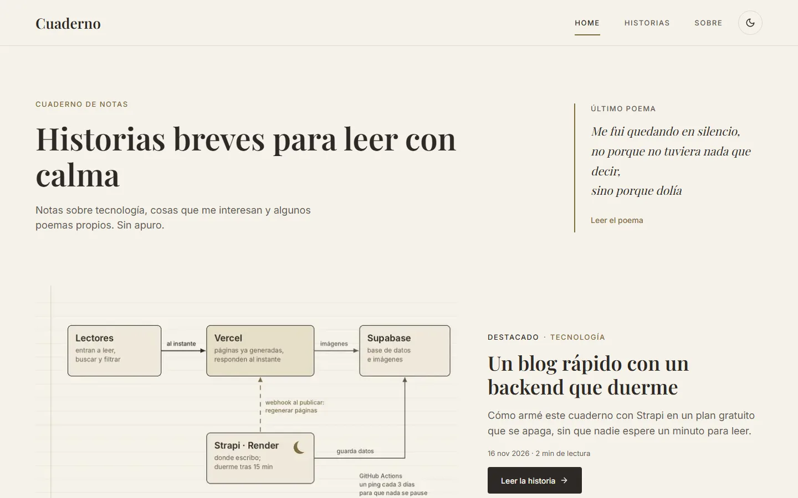
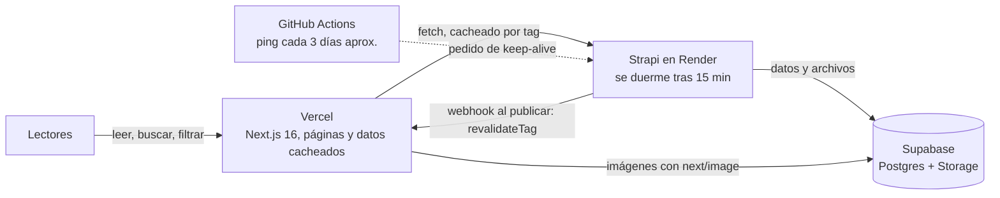
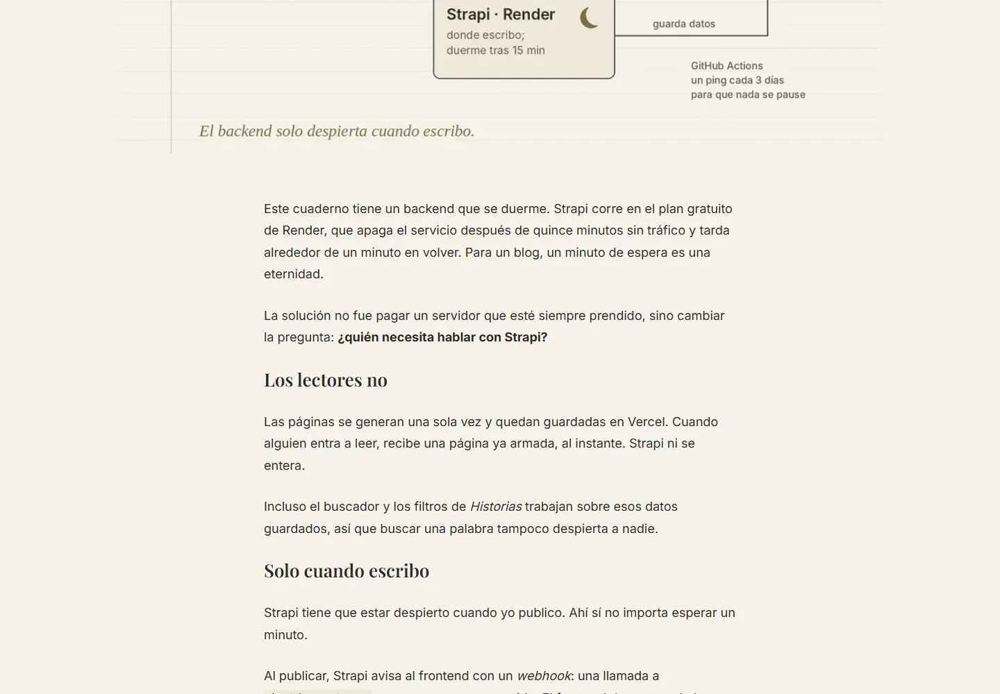
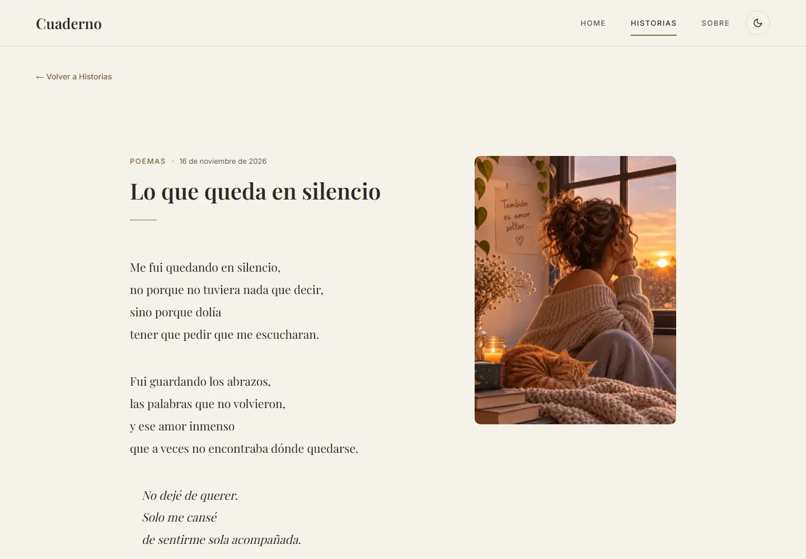
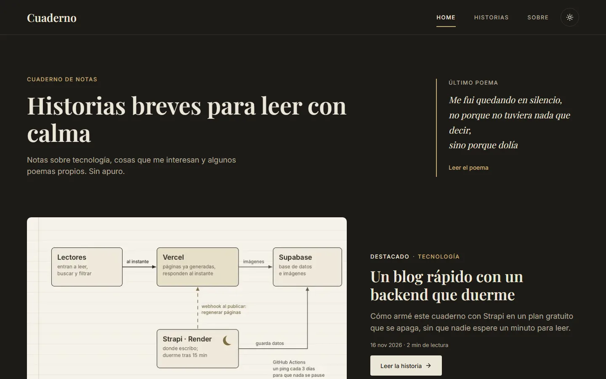
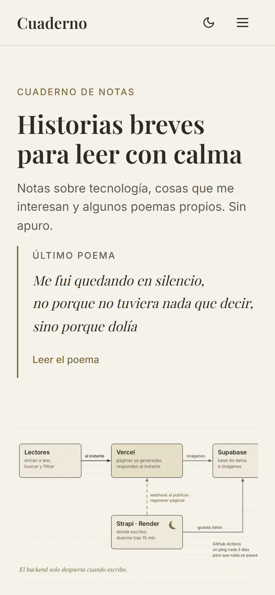

[English](README.md) · **Español**

# Cuaderno

Un sitio de lectura de historias breves, notas y poemas: Next.js 16 sobre un backend Strapi headless que se duerme en un plan gratuito, pensado para que los lectores casi nunca lo noten.

**Stack:** Next.js 16 · React 19 · TypeScript · Tailwind CSS 4 · Strapi 5 · Supabase · Vercel · Vitest

[**Sitio en vivo**](https://mini-blog-frontend-rouge.vercel.app) · [Repositorio del backend](https://github.com/tatianadelsoglio/mini-blog-backend) · [](https://github.com/tatianadelsoglio/mini-blog-frontend/actions/workflows/ci.yml)



## Por qué este proyecto

Cuaderno es un blog personal y un proyecto de portfolio: un CMS donde escribo, un diseño propio y un hosting en planes gratuitos. La restricción interesante es que el plan gratuito de Render duerme a Strapi tras 15 minutos y tarda alrededor de un minuto en despertarlo. La arquitectura gira en torno a eso: Vercel sirve páginas y datos cacheados, así que los lectores casi nunca dependen de que el backend esté despierto, y Strapi solo tiene que estar despierto cuando publico.

## Funcionalidades

- **Lectura:** páginas de post con layout de prosa (Markdown + GFM: tablas, notas al pie, bloques de código con nombre de archivo y botón de copiar, figuras con pie de foto), tiempo de lectura y navegación entre el post anterior y el siguiente.
- **Historias (el archivo):** una página con búsqueda de texto (sin distinguir mayúsculas ni tildes, sobre título, extracto y cuerpo), filtro por categoría y paginación. Es un formulario GET común: funciona sin JavaScript y todo el estado queda en la URL.
- **Poemas con formato propio:** los poemas no pasan por el renderizador de Markdown. Un parser propio respeta estrofas, saltos de línea, sangría de 4 espacios, cursivas/negritas y el ornamento `* * *` tal como se escribieron, y la home muestra los primeros versos del último poema.
- **Modo oscuro sin parpadeo:** un script inline mínimo fija el tema antes del primer pintado. Sigue `prefers-color-scheme` hasta que elegís uno, y recuerda la elección.
- **Menú mobile con el `<dialog>` nativo:** se abre con `showModal()`, así que el comportamiento modal del navegador aporta cierre con Esc, fondo inerte y foco contenido; al cerrar, el foco vuelve al botón del menú.
- **SEO:** metadata por página con URLs canónicas y Open Graph, imagen OG por defecto generada, `sitemap.xml` armado con los posts, `robots.txt` y `noindex` en los resultados de búsqueda.

## Arquitectura



**Por qué el lector casi nunca espera al backend dormido.** Cada consulta a Strapi pasa por la caché de datos de Next (`force-cache` con tags). Las páginas de los posts se prerenderizan, y `/historias` se renderiza en cada request (lee la query string) pero toma los datos de la misma caché, así que Vercel atiende al visitante sin tocar Strapi.

A Strapi se lo consulta solo cuando la caché está vacía o vencida: en el build, después de que el webhook invalida un tag, o cuando se cumple la revalidación de respaldo de 7 días (se sirven datos viejos mientras se regenera en segundo plano). El webhook se dispara cuando publico, que es cuando Strapi está despierto porque lo estoy usando.

Un workflow de GitHub Actions del repo del backend consulta a Strapi cada 3 días, aproximadamente, para que Render y el proyecto de Supabase no pasen mucho tiempo inactivos. El único caso en que un lector podría esperar (la primera visita después de una publicación) está descrito en Limitaciones.

## Decisiones técnicas

- **Caché con tags y webhook con secreto.** Las consultas de datos se cachean con los tags `posts`, `categories` y `about`; `POST /api/revalidate` traduce el modelo del evento de Strapi a los tags que hay que expirar (un cambio de categoría también expira `posts`, porque los posts incluyen el nombre de su categoría; un modelo desconocido invalida todo antes que arriesgar contenido viejo). El header secreto se compara con `timingSafeEqual` y el body se valida antes de revalidar nada. *Por qué:* las ediciones llegan al sitio en segundos, sin rebuilds ni polling.
- **Validación zod item por item, con degradación.** Las listas de Strapi se validan con un sobre laxo más un `safeParse` por item. Un item inválido se descarta y se loguea una vez en lugar de romper la página entera, los campos nulos se normalizan, una imagen faltante pasa a `null`, una imagen de un host no permitido se omite en vez de romper `next/image`, y los links externos del CMS tienen que ser `https://`. *Por qué:* el contenido se edita a mano en un CMS, y una entrada mal cargada no debería tumbar el sitio.
- **Búsqueda y filtros sobre datos cacheados.** Los posts se piden una vez (todas las páginas de Strapi) y quedan en la caché; la búsqueda, el filtro por categoría, la paginación y la resolución de slugs corren sobre ese array. Un slug inexistente es un 404 sin consultar a Strapi. *Por qué:* buscar nunca despierta al backend, y para un blog de este tamaño un recorrido simple es más rápido y simple que un servicio de búsqueda externo. El costo está en Limitaciones.
- **Diseño propio en pen.dev, tokens en Tailwind 4.** Las pantallas están diseñadas en [`design/cuaderno.pen`](design/cuaderno.pen), y los colores (juegos claro y oscuro), la escala tipográfica, los espaciados y los tamaños de componentes viven como variables CSS expuestas con el `@theme` de Tailwind 4. Los componentes consumen tokens, no valores sueltos. *Por qué:* el diseño es la única fuente de verdad y el tema oscuro es un cambio de variables.
- **Accesibilidad incorporada, con contraste medido.** Lo implementado: landmarks y navegaciones con nombre, `aria-current` en el link y la página activos, un formulario `role="search"` con etiqueta, feedback `aria-live` en el botón de copiar, anillo de foco visible, áreas táctiles de 44 px mediante un token, `prefers-reduced-motion`, íconos decorativos ocultos a las tecnologías de asistencia y links externos anunciados como "abre en otra pestaña". Calculado a partir de los tokens del diseño, el texto primario y el secundario llegan a unos 12,9:1 y 6,2:1 sobre el fondo claro (14,0:1 y 7,6:1 en oscuro). Esto *no* es una auditoría WCAG formal y no afirmo conformidad.
- **Tests, y una comprobación de que realmente pueden fallar.** Vitest cubre la lógica que importa (ver Tests y CI). Después de escribirlos rompí a propósito la comparación del secreto y el parser de bloques de código y confirmé que la suite fallaba; después restauré el código. Fue una comprobación manual, no una herramienta automática de mutation testing.

## Stack en detalle

Next.js 16 (App Router, Server Components) · React 19 · TypeScript · Tailwind CSS 4 · zod 4 · react-markdown + remark-gfm · Vitest + Testing Library · ESLint · Fuentes: Playfair Display, Inter, JetBrains Mono · Hosting: Vercel · CMS: Strapi 5 en Render · Datos y archivos: Supabase.

## Galería

| Post de prosa | Poema con portada lateral |
| --- | --- |
|  |  |

| Modo oscuro | Mobile (390 px) |
| --- | --- |
|  |  |

## Correrlo localmente

**Requisitos:** Node.js según [`.nvmrc`](.nvmrc) (24, la misma versión mayor que usa Vercel) y un Strapi corriendo desde el [repo del backend](https://github.com/tatianadelsoglio/mini-blog-backend) (en local usa SQLite y subidas locales si no configurás Postgres y Supabase).

```bash
npm ci
cp .env.example .env   # y editá los valores
npm run dev            # http://localhost:3000
```

| Variable | Para qué sirve |
| --- | --- |
| `STRAPI_URL` | URL base de la API de Strapi. Obligatoria. Solo del lado del servidor (build, ISR y route handlers). |
| `SUPABASE_PUBLIC_URL` | URL pública del bucket de Supabase Storage, con el nombre del bucket. Permite que `next/image` cargue esas imágenes. |
| `REVALIDATE_SECRET` | Secreto compartido con el webhook de Strapi (header `x-revalidate-secret`) hacia `/api/revalidate`. Usá un valor largo y aleatorio. |
| `SITE_URL` | URL pública del sitio, para URLs canónicas, sitemap y Open Graph. En Vercel, si falta, usa el dominio de producción del proyecto. |

| Script | Qué hace |
| --- | --- |
| `npm run dev` | Servidor de desarrollo |
| `npm run build` / `npm start` | Build y servidor de producción (el build necesita un Strapi accesible) |
| `npm run lint` | ESLint |
| `npm run typecheck` | `next typegen` + `tsc --noEmit` |
| `npm test` | Vitest, una sola corrida (`npm run test:watch` para modo watch) |

## Tests y CI

**Qué se prueba** (138 tests con Vitest; Testing Library solo para el renderizador de Markdown):

- Validación con zod: los items válidos pasan, los inválidos se descartan uno por uno, y una imagen faltante o no permitida degrada a `null`.
- El parser de poemas: estrofas, líneas vacías, sangría de 4 espacios, cursivas, el separador `* * *` y la vista previa de los primeros versos.
- Resolución de slug contra la lista cacheada, paginación (rango, truncado con "…", 404 fuera de rango), búsqueda y filtro por categoría.
- El handler de `/api/revalidate`: 401 sin secreto o con uno incorrecto, 400 con body inválido y las llamadas correctas a `revalidateTag` (con mock).
- El Markdown del cuerpo: el `title=` de un bloque de código como nombre de archivo, con el lenguaje como alternativa, y una imagen sola renderizada como `figure` con `figcaption`.
- Fechas en zona horaria de Argentina, tiempo de lectura y pluralización.

**CI** ([`.github/workflows/ci.yml`](.github/workflows/ci.yml)) corre en cada push y pull request a `main`: `npm ci`, lint, typecheck y tests, con la versión de Node de `.nvmrc` y caché de npm.

**Por qué el CI no corre `next build`:** el build pide contenido real a Strapi, que se duerme en el plan gratuito y tarda alrededor de un minuto en despertar; un build en CI sería lento e inestable por motivos ajenos al código. Vercel ya compila contra el backend real en cada deploy y en cada preview, que es donde aparece un build roto.

## Limitaciones

- **Arranque en frío cuando edito.** El plan gratuito de Render duerme a Strapi tras 15 minutos sin tráfico y necesita alrededor de un minuto para despertar. Los lectores casi no se ven afectados, pero la primera vez que abro el admin o publico después de un rato sin uso, espero. Como el webhook expira la caché de inmediato, la primera visita tras una publicación también se regenera consultando a Strapi (que en ese momento está despierto, porque lo acabo de usar).
- **Planes gratuitos.** Strapi corre en el plan gratuito de Render (512 MB de RAM y disco efímero, por eso las subidas van a Supabase Storage). El workflow de keep-alive deja de correr si el repo del backend pasa 60 días sin actividad, hasta que se lo reactiva en GitHub.
- **Búsqueda simple.** Es una coincidencia de subcadena sobre todos los posts cacheados, sin ranking ni índice. Alcanza para un blog chico y no escalaría a miles de posts.
- **Solo en español.** La interfaz y el contenido están en español; no hay capa de i18n.
- **La accesibilidad no está auditada.** Ver la nota en Decisiones técnicas.

## Diseño

Las pantallas están diseñadas en pen.dev: [`design/cuaderno.pen`](design/cuaderno.pen) (un archivo binario que se abre con la app de pen.dev; los assets de marca están en [`design/assets`](design/assets)).

## Autora

Diseño y desarrollo: **Tatiana Delsoglio** · TAMADE, desarrolladora fullstack.
[GitHub](https://github.com/tatianadelsoglio) · [LinkedIn](https://www.linkedin.com/in/tatiana-delsoglio/)
