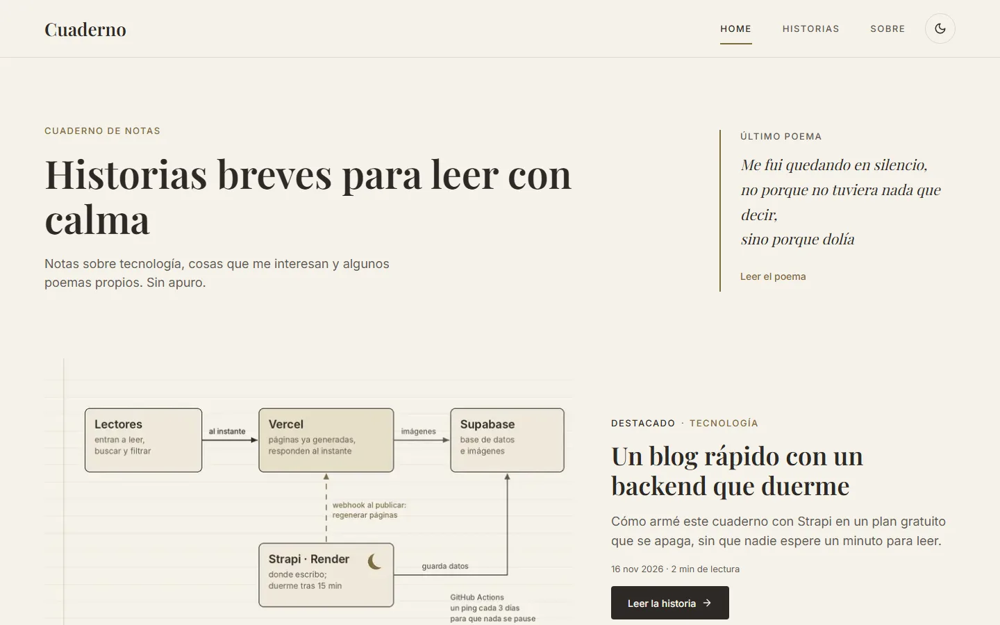
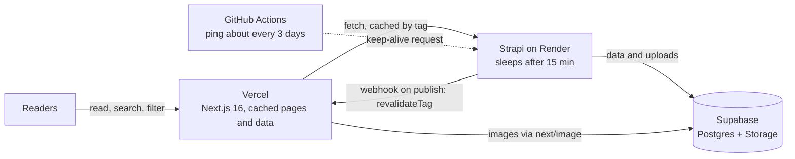
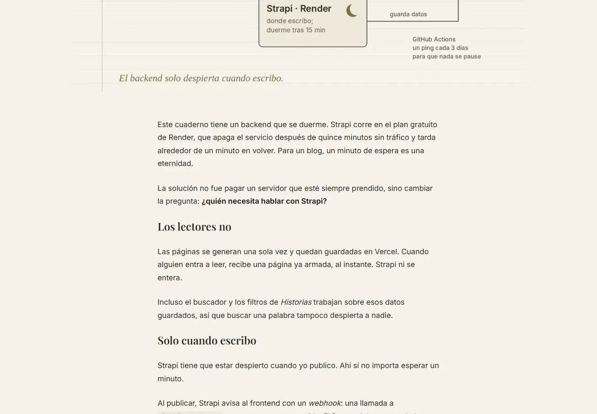
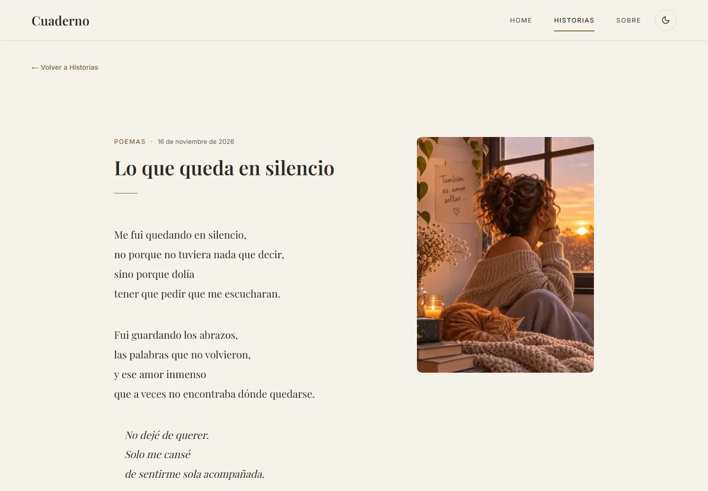
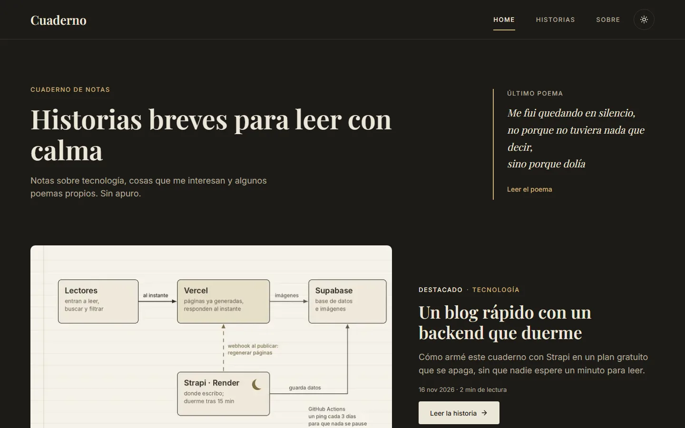
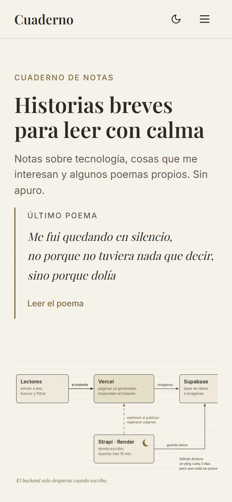

**English** · [Español](README.es.md)

# Cuaderno

A small reading site for short stories, notes and poems: Next.js 16 on top of a headless Strapi backend that sleeps on a free hosting plan, built so readers almost never feel it.

**Stack:** Next.js 16 · React 19 · TypeScript · Tailwind CSS 4 · Strapi 5 · Supabase · Vercel · Vitest

[**Live site**](https://mini-blog-frontend-rouge.vercel.app) · [Backend repository](https://github.com/tatianadelsoglio/mini-blog-backend) · [](https://github.com/tatianadelsoglio/mini-blog-frontend/actions/workflows/ci.yml)



## Why this project

Cuaderno is a personal blog and a portfolio project: a CMS I write in, a custom design, and a free-tier hosting setup. The interesting constraint is that the free Render plan puts Strapi to sleep after 15 minutes and takes about a minute to wake it up. The architecture is built around that: Vercel serves cached pages and cached data, so readers almost never depend on the backend being awake, and Strapi only has to be awake when I publish.

## Features

- **Reading:** post pages with a prose layout (Markdown + GFM: tables, footnotes, code blocks with a file name and a copy button, figures with captions), reading time, and previous/next navigation.
- **Historias (the archive):** a page with text search (accent- and case-insensitive, over title, excerpt and body), category filter and pagination. It is a plain GET form, so it works without JavaScript and every state lives in the URL.
- **Poems with their own format:** poems skip the Markdown renderer. A dedicated parser keeps stanzas, line breaks, 4-space indentation, italics/bold and the `* * *` ornament exactly as written, and the home page shows the first lines of the latest poem.
- **Dark mode without flicker:** a tiny inline script sets the theme before the first paint. It follows `prefers-color-scheme` until you choose, and remembers the choice.
- **Mobile menu on the native `<dialog>`:** it opens with `showModal()`, so the browser's modal behavior provides Esc to close, an inert background and focus containment; focus returns to the menu button on close.
- **SEO:** per-page metadata with canonical URLs and Open Graph, a generated default OG image, `sitemap.xml` built from the posts, `robots.txt`, and `noindex` on search-result pages.

## Architecture



**Why readers almost never wait for the sleeping backend.** Every request to Strapi goes through Next's data cache (`force-cache` with tags). Post pages are prerendered, and `/historias` renders per request (it reads the query string) but takes its data from the same cache, so a visitor is served by Vercel without touching Strapi.

Strapi is only called when the cache is empty or expired: at build time, after the webhook invalidates a tag, or when the 7-day fallback revalidation kicks in (stale data is served while it regenerates in the background). The webhook fires when I publish, which is when Strapi is awake because I am using it.

A GitHub Actions workflow in the backend repo pings Strapi about every 3 days so Render and the Supabase project don't stay idle for long. The one case where a reader could wait (the first visit after a publish) is described under Limitations.

## Technical decisions

- **Tag-based cache and a webhook with a secret.** Data fetches are cached with the tags `posts`, `categories` and `about`; `POST /api/revalidate` maps the Strapi event's model to the tags to expire (a category change also expires `posts`, because posts embed the category name; an unknown model invalidates everything rather than risk stale content). The secret header is compared with `timingSafeEqual`, and the body is validated before anything is revalidated. *Why:* content updates reach the site within seconds without rebuilds and without polling.
- **Item-by-item zod validation with degradation.** Strapi lists are validated with a loose envelope plus one `safeParse` per item. An invalid item is dropped and logged once instead of failing the whole page, nullable fields are normalized, a missing image becomes `null`, an image from a host that is not allowed is skipped instead of crashing `next/image`, and external links from the CMS must be `https://`. *Why:* the content is edited by hand in a CMS, so one bad entry should not take the site down.
- **Search and filters over cached data.** Posts are fetched once (all pages from Strapi) and stored in the cache; search, category filter, pagination and slug lookup run on that array. An unknown slug is a 404 without calling Strapi. *Why:* searching never wakes the backend, and for a blog of this size a simple scan is faster and simpler than an external search service. The trade-off is in Limitations.
- **Custom design in pen.dev, tokens in Tailwind 4.** The screens are designed in [`design/cuaderno.pen`](design/cuaderno.pen), and the colors (light and dark sets), type scale, spacing and component sizes live as CSS variables exposed through Tailwind 4's `@theme`. Components consume tokens, not raw values. *Why:* the design stays the single source of truth and the dark theme is a variable swap.
- **Accessibility built in, with measured contrast.** What is implemented: landmarks and labelled navigation, `aria-current` on the active link and page, a `role="search"` form with a label, `aria-live` feedback on the copy button, a visible focus ring, 44 px-class touch targets via a token, `prefers-reduced-motion`, decorative icons hidden from assistive technology, and external links announced as opening in a new tab. Computed from the design tokens, the primary and secondary text colors reach about 12.9:1 and 6.2:1 on the light background (14.0:1 and 7.6:1 in dark). This is *not* a formal WCAG audit and I make no conformance claim.
- **Tests, and a check that they can actually fail.** Vitest covers the logic that matters (see Tests and CI). After writing them I broke the secret comparison and the code-fence parser on purpose and confirmed the suite went red, then restored the code. That was a manual check, not an automated mutation-testing tool.

## Stack in detail

Next.js 16 (App Router, Server Components) · React 19 · TypeScript · Tailwind CSS 4 · zod 4 · react-markdown + remark-gfm · Vitest + Testing Library · ESLint · Fonts: Playfair Display, Inter, JetBrains Mono · Hosting: Vercel · CMS: Strapi 5 on Render · Data and files: Supabase.

## Gallery

| Prose post | Poem with a side cover |
| --- | --- |
|  |  |

| Dark mode | Mobile (390 px) |
| --- | --- |
|  |  |

## Run it locally

**Requirements:** Node.js as in [`.nvmrc`](.nvmrc) (24, the same major version Vercel runs), and a running Strapi from the [backend repo](https://github.com/tatianadelsoglio/mini-blog-backend) (locally it falls back to SQLite and local uploads if you don't configure Postgres and Supabase).

```bash
npm ci
cp .env.example .env   # then edit the values
npm run dev            # http://localhost:3000
```

| Variable | What it is for |
| --- | --- |
| `STRAPI_URL` | Base URL of the Strapi API. Required. Server-side only (build, ISR and route handlers). |
| `SUPABASE_PUBLIC_URL` | Public URL of the Supabase Storage bucket, including the bucket name. Allows `next/image` to load those images. |
| `REVALIDATE_SECRET` | Shared secret for the Strapi webhook (`x-revalidate-secret` header) calling `/api/revalidate`. Use a long random value. |
| `SITE_URL` | Public URL of the site, used for canonical URLs, the sitemap and Open Graph. On Vercel it falls back to the project's production domain. |

| Script | What it does |
| --- | --- |
| `npm run dev` | Development server |
| `npm run build` / `npm start` | Production build and server (the build needs a reachable Strapi) |
| `npm run lint` | ESLint |
| `npm run typecheck` | `next typegen` + `tsc --noEmit` |
| `npm test` | Vitest, single run (`npm run test:watch` for watch mode) |

## Tests and CI

**What is tested** (138 tests, Vitest; Testing Library only for the Markdown renderer):

- zod validation: valid items pass, invalid ones are dropped one by one, a missing or disallowed image degrades to `null`.
- The poem parser: stanzas, blank lines, 4-space indentation, italics, the `* * *` separator and the first lines preview.
- Slug lookup against the cached list, pagination (range, truncation with "…", 404 out of range), search and category filter.
- The `/api/revalidate` handler: 401 without or with a wrong secret, 400 on an invalid body, and the right `revalidateTag` calls (mocked).
- The Markdown body: `title=` of a code fence as the file name, falling back to the language, and a lone image rendered as `figure` with `figcaption`.
- Argentina-timezone dates, reading time and pluralization.

**CI** ([`.github/workflows/ci.yml`](.github/workflows/ci.yml)) runs on every push and pull request to `main`: `npm ci`, lint, typecheck and tests, on the Node version from `.nvmrc`, with the npm cache.

**Why CI does not run `next build`:** the build fetches real content from Strapi, which sleeps on the free plan and takes about a minute to wake up, so a CI build would be slow and flaky for reasons unrelated to the code. Vercel already builds against the real backend on every deploy and preview, which is where a broken build shows up.

## Limitations

- **Cold start when I edit.** Render's free plan sleeps Strapi after 15 minutes without traffic and needs about a minute to wake. Readers are mostly unaffected, but the first time I open the admin or publish after a quiet period, I wait. Because the webhook expires the cache immediately, the first visit after a publish regenerates against Strapi too (which is awake at that point, since I just used it).
- **Free plans.** Strapi runs on Render's free plan (512 MB of RAM, ephemeral disk, which is why uploads go to Supabase Storage). The keep-alive workflow stops running if the backend repo has no activity for 60 days, until it is re-enabled in GitHub.
- **Simple search.** It is a substring match over all cached posts, with no ranking or index. That is fine for a small blog and would not scale to thousands of posts.
- **Spanish only.** The interface and content are in Spanish; there is no i18n layer.
- **Accessibility is not audited.** See the note in Technical decisions.

## Design

The screens are designed in pen.dev: [`design/cuaderno.pen`](design/cuaderno.pen) (a binary file that opens in the pen.dev app; brand assets are in [`design/assets`](design/assets)).

## Author

Designed and developed by **Tatiana Delsoglio** · TAMADE, fullstack developer.
[GitHub](https://github.com/tatianadelsoglio) · [LinkedIn](https://www.linkedin.com/in/tatiana-delsoglio/)
